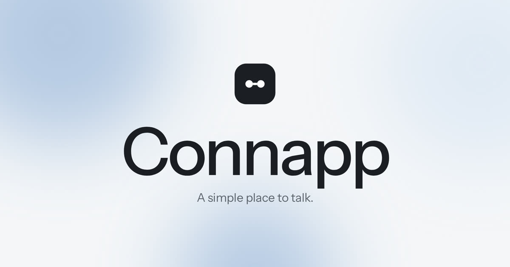

<p align="center">
  
</p>

# Connapp

**A simple place to talk.**

Connapp is a minimal messaging app built around private rooms — no feeds, no scores, no performance. Open a room, say what you mean, leave it there.

---

## Features

| Feature | Description |
|--------|-------------|
| **Named rooms** | Conversations have a purpose. When the work is done, the room stays finished. |
| **Quiet presence** | See who’s in the room. No last-seen clocks or green-dot theater. |
| **Nothing public** | What is said stays in the room. No feed, no follower count, no profile to perform. |
| **Realtime chat** | 1:1 messages update live via Supabase Realtime. |
| **Edit / delete** | Edit your message within 5 minutes; delete anytime. |
| **Block user** | Block (and unblock) from the chat menu. |
| **Hide chat** | Hide a conversation; triple-tap the Connapp logo on Dashboard to open the secret vault. |
| **Accounts** | Sign up, log in, edit name, username, bio, photo, password. |
| **Mobile** | Responsive layout with safe-area padding. |

---

## Pages

| File | Purpose |
|------|---------|
| `index.html` | Landing page |
| `signup.html` | Create account |
| `login.html` | Log in |
| `dash.html` | Search people → open chat |
| `chat.html` | 1:1 realtime messaging |
| `account.html` | Profile & password settings |
| `supabase.sql` | Database schema + RLS + Realtime |
| `banner.jpeg` | Brand banner |

---

## Quick start

### 1. Supabase setup

1. Open your [Supabase project](https://supabase.com/dashboard).
2. Go to **SQL Editor** → paste and run everything in `supabase.sql`.
3. Confirm Realtime is on for `messages`:

```sql
ALTER TABLE public.messages REPLICA IDENTITY FULL;
SELECT * FROM pg_publication_tables WHERE pubname = 'supabase_realtime';
```

You should see a row for `messages`.

Re-run the full `supabase.sql` if you already set up earlier — it adds `edited_at`, `deleted_at`, `blocks`, and `hidden_chats`.

4. (Optional for local testing) **Authentication → Providers → Email** → turn **off** “Confirm email” so signup logs you in immediately.

### 2. Run the app

**Option A — open files directly**

Open `index.html` in a browser. Prefer a local server if the CDN is blocked:

```bash
cd connapp
python3 -m http.server 5500
```

Then visit: [http://localhost:5500](http://localhost:5500)

**Option B — any static host**

Upload the whole `connapp` folder to Netlify, Vercel, GitHub Pages, etc.

### 3. Use it

1. **Create account** → lands on Dashboard  
2. Open another browser / incognito → create a second account  
3. Search each other by username → open chat  
4. Send messages — they appear live  

---

## Tech

- **Frontend:** Plain HTML, CSS, JavaScript (no build step)
- **Backend:** [Supabase](https://supabase.com) (Auth + Postgres + Realtime)
- **Mobile:** Responsive layout with safe-area padding on chat composer

Config is already wired in every page:

```text
URL:  https://ktoyxbqybthleiiiiruv.supabase.co
Anon: (embedded in each page — public by design; protect data with RLS)
```

---

## Auth & security notes

- Login and signup use **`type="button"`** handlers — credentials never appear in the URL.
- Row Level Security (RLS) restricts messages to participants only.
- Profiles are readable for search; only the owner can update their own profile.
- Change any demo password that may have appeared in an old form URL.

---

## Project structure

```text
connapp/
├── index.html      # Landing
├── signup.html     # Sign up
├── login.html      # Log in
├── dash.html       # Find people
├── chat.html       # Messaging
├── account.html    # Settings
├── supabase.sql    # Schema
├── banner.jpeg     # Brand art
└── README.md       # This file
```

---

## License

Built for demos and personal use. Connapp branding and copy are part of the product concept.

---

<p align="center">
  <strong>Messaging, held simply.</strong>
</p>
